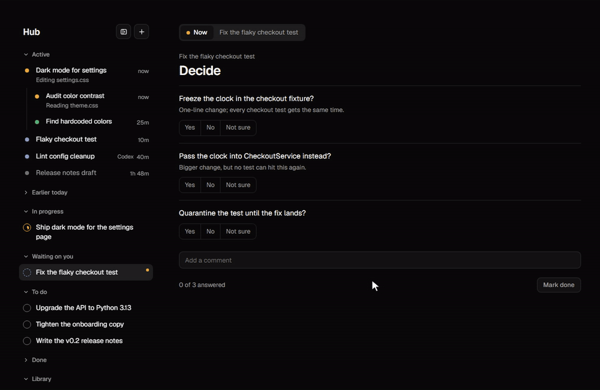
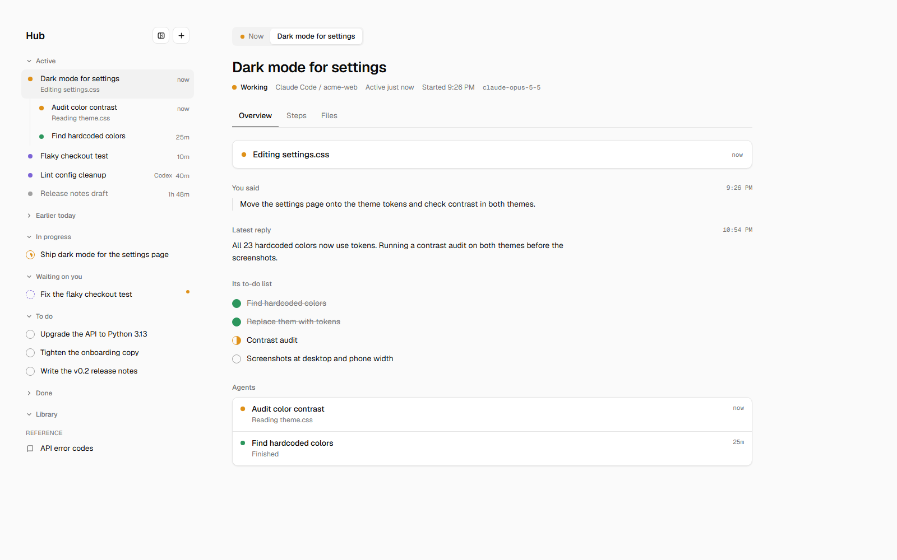
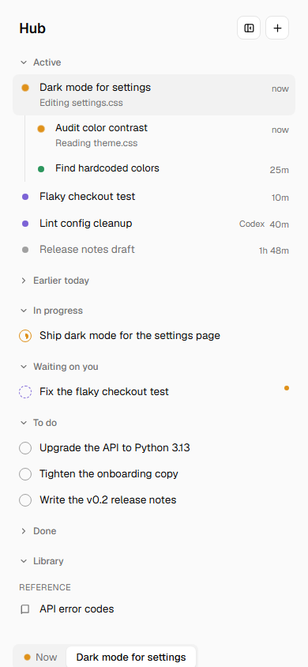

# crewboard

One screen for every Claude Code session and subagent on your machine, plus a task list that your agents and you both write.



Run five Claude Code sessions, each spawning agents, and the question stops being "what is Claude doing" and becomes "what is everything doing, and what is waiting on me". crewboard answers it on one page:

- **Active** (left, top): every session and its subagents, live. Working, waiting on you, finished, or stopped, with the one line of what each is doing right now. It reads the transcripts Claude Code already writes. Nothing to install in your sessions, no hooks, no API key.
- **Tasks** (left, below): a plain JSON task list. You click it; agents edit it. Tasks hold subtasks, dated notes and pages.
- **Center**: the task or session you picked. A session shows what you last said, its latest reply, its own to-do list, its agents, every step it took and the files it touched.
- **Now**: whatever an agent says you are talking about right now, such as a page of yes/no questions it needs you to answer.

<p>


</p>

Python 3.9+, standard library only. Windows, macOS and Linux.

## Quickstart (5 minutes)

```bash
git clone https://github.com/VyasSathya/crewboard
cd crewboard
python -m crewboard serve --demo --open
```

`--demo` serves the example tasks and example sessions from a temporary copy, so you can click around without touching anything.

Then the real thing:

```bash
python -m crewboard --open
```

It finds your Claude Code transcripts on its own (`$CLAUDE_CONFIG_DIR`, else `~/.claude`) and keeps the task list at `~/.crewboard/progress.json`. Open http://localhost:7788/ and leave it on a second screen.

Then let your agents write to the list from any folder:

```bash
pip install -e .
```

That adds a `crewboard` command (same subcommands as `python -m crewboard`). Paste the snippet under [For your agents](#for-your-agents) into your `~/.claude/CLAUDE.md`.

## What it reads

All read-only. The server never writes to these files and never calls a model.

| Source | Where | What for |
|---|---|---|
| Transcripts | `<claude dir>/projects/*/*.jsonl` | sessions: messages, tool calls, to-do lists, state |
| Subagents | `<claude dir>/projects/*/<session>/subagents/agent-*.jsonl` and `.meta.json` | agents nested under their session |
| Process registry | `<claude dir>/sessions/*.json` | whether a session's process is still running |
| Desktop app (optional) | Windows `%APPDATA%\Claude`, macOS `~/Library/Application Support/Claude`, Linux `~/.config/Claude`, under `claude-code-sessions/` | session titles, archived sessions hidden |
| Codex (optional) | `$CODEX_HOME` or `~/.codex`, `state_*.sqlite` | Codex threads, if you also use Codex |

Sessions show for a day after their last activity. Text that looks like a key or token (API keys, bearer tokens, JWTs, long hex) is redacted before it reaches the page.

The server binds to `127.0.0.1` only. The page shows what your sessions are doing; it is not meant for a network.

## The task list

One JSON file. The page, the command line and your agents all edit the same file.

```json
{
  "rev": 12,
  "focus": {"task": "flaky-checkout", "page": "decide"},
  "items": [
    {
      "id": "flaky-checkout",
      "title": "Fix the flaky checkout test",
      "status": "waiting",
      "area": "Backend",
      "added": "2026-10-15",
      "due": null,
      "done": null,
      "notes": [{"date": "2026-10-16", "text": "Cause: the test reads the clock twice."}],
      "items": [{"id": "fc-1", "title": "Reproduce with a frozen clock", "status": "done"}],
      "pages": [
        {
          "id": "decide", "kind": "ask", "title": "Decide",
          "choices": ["Yes", "No", "Not sure"],
          "items": [{"id": "freeze", "line": "Freeze the clock in the fixture?", "sub": "One-line change."}]
        }
      ]
    }
  ]
}
```

- `status` is `open`, `doing`, `waiting` (on you) or `done`. The list groups by it.
- `items` are subtasks, same shape.
- `pages` are tabs on the task. Two kinds:
  - `ask`: lines you answer with one of `choices`; your click sets `answer` on the line. Comments and a done button come with it. A task with unanswered questions gets a dot in the list.
  - `raw`: an `html` string shown as is. Only your own agents write this file, so it is treated as trusted.
- `ref: true` with a `shelf` puts an item in the Library instead of the to-do groups, for reference material that is not a task.
- `focus` is what the Now view shows: a task, optionally one of its pages, or `{task, title, text}`.

See [`crewboard/examples/progress.json`](crewboard/examples/progress.json) for a full example.

## The write rule

Every writer follows one rule, so nobody erases anyone else's edit:

1. Read the latest file.
2. Change only what you mean to change.
3. Set `rev` to exactly one more than the `rev` you read.
4. Write the whole file, ASCII only (`json.dump(doc, fh, ensure_ascii=True)`), to a temp file, then rename it over the original.

The server refuses a save whose `rev` is not exactly one more than the file on disk (HTTP 409), and the page then re-reads and retries. Every version is copied to `history/progress-revNNNNN.json` next to the file, whoever wrote it, so nothing is ever lost.

The command line does all four steps for you and retries if someone wrote in between:

```bash
python -m crewboard add "Upgrade to Python 3.13" --id py313 --status open --area Backend
python -m crewboard note py313 "Two dependencies pin older versions."
python -m crewboard status py313 doing
python -m crewboard focus py313
python -m crewboard sessions          # what every session and agent is doing, in the terminal
```

## For your agents

Paste this into `~/.claude/CLAUDE.md` (or a project's `CLAUDE.md`):

```markdown
## Task list (crewboard)

The shared task list is ~/.crewboard/progress.json; the user watches it at http://localhost:7788/.
At each checkpoint (a new request, a step done, a finding, something waiting on the user), update it:

- `crewboard add "Title" --id <short-id> --status doing` for new work,
  `note <id> "text"` for progress, `status <id> waiting|done` when it changes.
- Questions for the user go in a page on the task: {"id", "kind": "ask", "title", "choices": [...],
  "items": [{"id", "line", "sub"}]}. Read their answers back from items[].answer.
- Set `focus <id> [--page <page-id>]` to show what you are talking about in the Now view.
- Editing the file directly: read the latest file, change only your own items, set rev to exactly
  the rev you read + 1, write with ensure_ascii. Never delete items; a stale write is retried, not forced.
```

## Configuration

Everything is auto-detected; override when you need to.

| Flag | Environment | Default |
|---|---|---|
| `--port` | `CREWBOARD_PORT` | `7788` (`0` picks a free port) |
| `--data` | `CREWBOARD_DATA` | `~/.crewboard/progress.json` |
| `--claude-dir` (repeatable) | `CREWBOARD_CLAUDE_DIRS` (path list), `CLAUDE_CONFIG_DIR` | `~/.claude` |
| | `CREWBOARD_DESKTOP_META` | the desktop app's `claude-code-sessions` folder |
| | `CODEX_HOME`, `CREWBOARD_NO_CODEX=1` | `~/.codex` |

Several Claude accounts or config dirs show on one screen with `--claude-dir` once per dir.

The page takes `?theme=dark` or `?theme=light` to override the system theme, `?id=<task>` for one task on its own, and `#<task-id>` or `#c:<session-id>` to open on a task or session.

## Development

```bash
python -m unittest discover -s tests
```

The tests cover the write rule (stale writes refused, concurrent writers, history kept, ASCII output), transcript parsing (states, tool lines, to-do lists, subagents, redaction, half-written lines) and the HTTP layer.

## License

MIT
